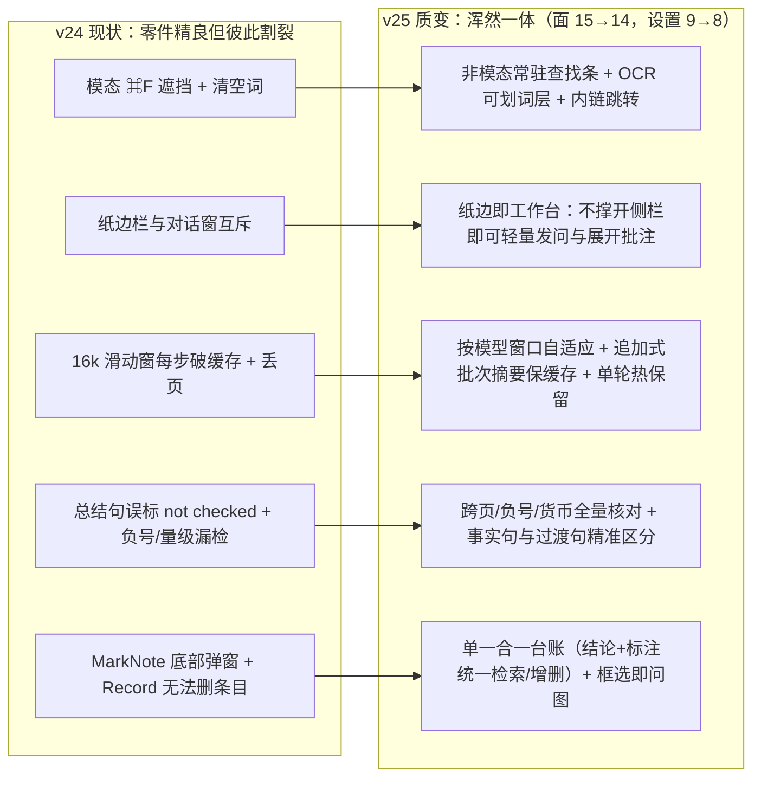

# PageWise v24.0.0 深度全面评审与 v25 质变蓝图

*评审基线：`main` `84bc3b7`（Tag `v24.0.0`，发布于 2026-10-18）。证据口径严格区分：**实测**（本环境执行构建、单测、评测集、UI 盘点与 13 屏实拍量得）、**读代码**（逐行核实的 `file:line`）、**上游**（GitHub API 实读）、**未量**（受真机或外部密钥限制未实跑）。*

---

## 0. 核心判断：为什么 24 个大版本后仍缺一次真正的「质变」？

PageWise 拥有桌面 AI 应用里极为罕见的**工程克制与局部工艺**：CI 强制门禁的复杂度预算、原子级 `fsync` 存储、Rust 侧单向路径授权、98.5% 的本地确定性引文核对与 100% 的篡改数字拦截。

但站在 `v24.0.0` 的真实运行界面与完整源码前审视，产品之所以还未发生「一用即惊艳」的质变（上游至今 `0 star / 0 fork`，v24.0.0 六个安装包合计下载 3 次），根本原因不在于「功能不够多」，而在于**五处核心机制在真实使用路径上互相抵消**，同时 **v24 自身的重点改动与底层管线仍存留 14 项高危（P0/P1）断层**：

1. **长回答上下文与缓存悖论**：`src/lib/compact-run-messages.ts` (compact-run-messages.ts:39) 将保留窗口硬锁在 `16,000` 字符（仅约 2.6 页），在 `prepareStep` 中每步改写历史工具消息——既**每步击穿服务商的 KV 前缀缓存**，又导致单步并行读页在模型看到前就被摘要抹掉，跨 5 页以上的制表/综述题陷入「重读前页 → 挤掉后页 → 双倍扣减 50k 预算直至拒绝重读」的死循环。
2. **纸边栏（Margin Column）可见性悖论**：v20 精心打造的纸边句级状态卡片与三车道引线（`src/features/preview/PageGutter.tsx` (PageGutter.tsx:296)）在默认打开对话面板时**完全隐藏**（`src/App.tsx` (App.tsx:518) `marginColumn={!s.assistant.open}`）；一旦收起面板看纸边，界面上又**没有任何提问入口**，点任意卡片或点「Ask」会立刻撑开面板并销毁纸边栏。
3. **阅读器基本功断层**：切换打开**任意第二份 PDF（`A → B`）会静默丢失 100% 的书签、印刷页码 `/PageLabels` 与批注，并白白将文件复制解析 16 次**（`src/session/useWorkbench.ts` (useWorkbench.ts:340) + `src/lib/pdf.ts` (pdf.ts:63)）；`⌘F` 是带黑色遮罩的模态弹窗，点一下命中就清空搜索词，无 `Enter` 下一个；扫描件本地 OCR 识别完后页面依然无法划词；框选图表/公式后只能建空白标注，不能提问。
4. **诚实核对的「误伤」与「盲区」并存**：系统提示词禁止模型给自己的分析总结句加引文标记（`src/lib/agent.ts` (agent.ts:167)），但句级统计却把这些过渡与归纳句全部标为刺眼的 `not checked`（实拍 `07b-answer-typography.png` 显示 `2 verified · 4 not checked`）；与此同时，正负号反转（`-3.2%` 写成 `+3.2%`）与英文量级篡改（`$5` 写成 `$5 million`）却在本地核对中拿到绿勾 `verified ✓`（`src/lib/quantities.ts` (quantities.ts:171)）。
5. **首分钟高门槛与台账死锁**：欢迎页无一键体验样本文档；点「本地模型（Ollama）」跳进折叠了 `Advanced` 的通用设置，根本找不到 Ollama；`Record` 面板没有删除结论入口（`removeFinding` 全仓零调用），划掉（Strike out）后回答永远卡死在 `Kept`。

> [!IMPORTANT]
> **v25 的核心命题（全方位质变，零复杂化）**：不加一个新面板、不加一个新 Tab、不加一个新模型工具，甚至将复杂度预算从 **15 个面降至 14 个面、9 行设置降至 8 行**，通过「打通五大断层 + 清零 P0/P1 数据与协议缺陷」，让 PageWise 从「24 个精巧零件的拼装」跃升为**浑然一体的原生级学术/合同阅读与取证器**。

---

## 1. 基线实测与上游信号盘点

### 1.1 本次环境实测结果（`v24.0.0` `84bc3b7`）

| 检查维度 | 命令 / 手段 | 实测结果 | 备注 |
|---|---|---|---|
| **复杂度预算** | `npm run check:budget` | **8/8 全绿** | `faces: 15`, `tabs: 7`, `commands: 12`, `scanKnobs: 2`, `settingsRows: 9`, `copyKeys: 511`, `cssLines: 6,308`, `srcLines: 43,058` |
| **前端与脚本单测** | `npm test` | **163 文件 / 1,362 测试全绿** | 含 CSS 零死类检查（454 定义类全部被引用）、i18n 511 键对齐、权限范围测试 |
| **生产构建与包检** | `npm run build` | **2.96s 通过** | 最大 chunk：`ai` 633.7 kB、`pdf` 521.1 kB、`index` 469.3 kB；`pdf.worker` 1,321.3 kB |
| **依赖安全审计** | `npm audit` | **1 个 High 漏洞** | `undici`（含 DoS、SRI 绕过、TLS 选项丢失等 8 个 GHSA） |
| **引文定位评测** | `eval/location.eval.ts` | **98.5%（1,007/1,022）** | `markdownKept` **98.4%**（744/756）、`elided` **97.6%**（362/371）、篡改误判 **0/2,116（0.0%）** |
| **数量核对评测** | `eval/numbers.eval.ts` | **100.0% 抓获（138/138）** | 诚实表述误报 **0/179**，单位换算误报 **0/32**（但漏测正负号与英文货币量级，见 §2.1） |
| **PDF 证据回写** | `eval/annotate.eval.ts` | **99.5%（626/629）** | 629 条全部写入并由 `pdf.js` 读回，626 条高亮下文字完全一致 |
| **检索评测** | `eval/search.eval.ts` | **Top-3 命中 32/36（88.9%）** | 首条命中 27/36；4 道未命中均为同义改写（如「保修期限」对「质保期」） |
| **UI 盘点与实拍** | `ui:inventory` + `ui:shots` | **18/18 断言通过，13 屏零报错** | 实拍图暴露 `⌘F` 遮挡排版、句级统计误伤、页边栏默认不可见等视觉问题 |
| **上游信号** | GitHub REST API | **0 Star / 0 Fork / 3 次下载** | `v24.0.0` 发布满 1 个月，DMG/AppImage/tar.gz 各下载 1 次，Windows 0 次；`live-eval.yml` 运行 **0 次** |

---

## 2. v24.0.0 深度代码与体验审查（逐层核实）

### 2.1 第一层：v24.0.0 新增特性的 6 处回归与未闭环缺陷

#### (1) [CRITICAL] 长回答压缩机制（`compact-run-messages.ts`）存在三重结构性失效
- **单步并行读页「未读先删」**（`src/lib/compact-run-messages.ts` (compact-run-messages.ts:128-153)、`src/lib/agent.ts` (agent.ts:294-307)）：`prepareStep` 在上一步工具返回后、下一步请求发出前执行，且 `KEEP_RECENT_MIN = 1` 按单个 `tool-result` part 计数而非按 step 计数。当模型在一步内并行调用 4 次 `read_pdf_page`（如共 22,000 字符 > `16,000`）时，前 2 页在**模型连一眼都没看到**之前就被压成 `[Read page 1, 5500 chars — omitted]`，同时照扣 `RUN_TOKEN_BUDGET`。
- **多页制表/综述的「乒乓驱逐」死循环**（`src/lib/compact-run-messages.ts` (compact-run-messages.ts:39)、`src/lib/agent.ts` (agent.ts:167-170)）：`16,000` 字符上限最多同时容纳约 2.6–4 页全文。面对跨 8 页的合同条款汇总表，模型读完 p1–8 后 p1–5 被摘要；遵照提示词重读 p1–3 以逐字引用时，同一轮 `prepareStep` 立刻将 p6–8 挤出为摘要！且每次重读不仅再次扣减 `RUN_TOKEN_BUDGET = 50,000`（`src/lib/agent-tools/reading.ts` (reading.ts:66)，15 页中文合同读一遍即耗尽预算，导致末尾重读直接报 `budgetExceeded` 拒绝返回原文），还因每步改写早期消息彻底破坏了 OpenAI / DeepSeek / Anthropic 的自动前缀缓存（Prompt Cache）。
- **截断范围摘要失真与 `pagesInResult` 误判**（`src/lib/prune-chat-history.ts` (prune-chat-history.ts:146-156)、`src/lib/compact-run-messages.ts` (compact-run-messages.ts:96-106)）：`read_pdf_range(1, 20)` 在第 2 页因长度截断时，`compactToolOutput` 仍按入参写成 `[Read pages 1–20...]` 误导模型以为已读完全文；`pagesInResult` 用正则 `/--- Page (\d+)/g` 匹配字符串，会把 `[already returned...]` 占位符里的页码也算作被压缩，误清仍在上下文中的后续重读页。

#### (2) [CRITICAL] `Keep` 去重逻辑将用户锁死：`removeFinding` 在整个前端零调用
- **代码证据**（`src/lib/finding-store.ts` (finding-store.ts:444-449)、`src/lib/finding-store.ts` (finding-store.ts:592-596)、`src/components/RecordPanel.tsx` (RecordPanel.tsx:398)）：v24 CHANGELOG 宣称「移除记录后可再次点击 Keep」，但单测直接调用了 `removeFinding()`，而真实 UI（`RecordPanel`）只有「划掉」（`setFindingStruck`）没有删除！`keptFromMessage` 与 `duplicateFinding` 均未排除 `f.struck === true`。一旦用户点 Keep 再去 Record 里点划掉，顶栏徽章归零，但回答下方永远灰显 `Kept` 无法恢复；且当存储满触发 `toast.storeFull`（提示「删除不再需要的条目腾出空间」）时，界面上根本没有删除按钮。

#### (3) [CRITICAL] 红色未找到引文的句子红色虚线下划线在常见 Markdown 中失效
- **代码证据**（`src/lib/remark-citations.ts` (remark-citations.ts:89-134)、`src/styles/app/04-chat.css` (04-chat.css:644)）：`splitTextNode` 只在包含 `〔...〕` 的那一个纯文本 AST 叶子节点内包裹 `.cite-claim`。模型习惯对关键数字加粗（如 `下降了 **14.2%**〔p3 "错误引文"〕`），此时紧邻标记前是 `strong` 节点，`text` 节点的 `before` 为空串，**整句完全不生成 `.cite-claim`，没有任何红色虚线**；同一句挂两颗引文（如 `〔p2 "真"〕〔p3 "假"〕`）时，相邻兄弟选择器 `.cite-claim:has(+ .cite-level-notFound)` 被中间的绿芯片隔断，同样完全不画线。

#### (4) [CRITICAL] 服务商错误分类器未解包 AI SDK 的 `RetryError`，真实运行中退化失效
- **代码证据**（`src/lib/llm.ts` (llm.ts:248-267)、`src/lib/llm.ts` (llm.ts:302-320)）：遇到 429（余额不足）、503（过载）或本地连接拒绝（Ollama 未启动）时，AI SDK 默认重试 2 次后抛出 `RetryError`，真实 `APICallError` 存放在 `error.lastError` 而 `error.cause` 为 `undefined`。`llm.ts` 只沿 `.cause` 链查找，导致 `statusCode`、`fields.code`、`fields.url` 全部丢失——专为本地模型写的 `isLocalUrl(fields.url)`（「Ollama 开着吗？」）在真实运行中成为不可达死代码。此外 `src/lib/vision-api.ts` (vision-api.ts:111-120) 捕获错误时直接丢弃状态码与 `t` 翻译函数，将英文错误文本硬塞回前端。

#### (5) [HIGH] 未连接 AI 时的「排队自动发送」两条主路径失灵
- **代码证据**（`src/pages/ChatPanel.tsx` (ChatPanel.tsx:182-207)、`src/components/EmptyState.tsx` (EmptyState.tsx:108)）：输入框占位符承诺「连接 AI 后自动发送」，但若用户输入问题后点击正上方醒目的主按钮 **「Connect AI」**（而非按回车），`setQueued` 根本不会执行，配好 Key 关闭设置后什么也不会发；反之若按回车打开设置后点 `Esc` 取消，`questionQueued` 永远留在 `true`，既持续显示错误提示，又会在日后任意一次打开设置保存 Key 时突然把旧草稿发出去。

#### (6) [HIGH] 引文省略号匹配（`locateElided`）与数字核对（`quantities.ts`）的漏检与误判
- **省略号与格式盲区**（`src/lib/quote-locate.ts` (quote-locate.ts:76)、`src/lib/quote-locate.ts` (quote-locate.ts:184-232)）：① 法律/学术常见的 `[...]`、`[…]`、`. . .`、`⋯` 100% 匹配失败（方括号留在词尾且不在 `DROPPED` 中）；② 首段 `folded.indexOf` 贪婪取整页第一次出现位置（若第 1 段是「甲方应当」且页首出现过一次，哪怕页尾紧挨第 2 段又出现一次，也会因距离 `> 600` 误判未找到）；③ 双栏页面按未分栏的 `folded` 下标算距离，允许右栏顶与左栏腰反向拼接通过；④ `inspect.rs` 生成的 `<u>下划线</u>` 标签与表格竖线 `|` 未剥离，模型原样复制必红；⑤ 跨页引文 `〔p12-13 "..."〕` 仍逐单页孤立查找（`src/lib/citation-check.ts` (citation-check.ts:227)），定位率仍为 **0%**。
- **正负号反转与英文货币量级绿勾漏检**（`src/lib/quantities.ts` (quantities.ts:28)、`src/lib/quantities.ts` (quantities.ts:171)）：`quote-locate.ts` 忽略 `-` 与 `−`，而 `quantities.ts` 正则完全不读负号且只认中文「万/亿」不认英文 `$`/`thousand`/`million`/`billion`——原文写 `−3.2%` 被模型写成 `+3.2%`，或原文写 `$5` 被写成 `$5 million`，在本地核对中均被判为 **`verified ✓`**！

---

### 2.2 第二层：PDF 管线、Rust 后端与持久化的 8 项系统级缺陷

1. **[CRITICAL] 会话内打开第二份 PDF（`A → B`）静默丢失全部书签、印刷页码与 PDF 批注，并重复解析 16 次**
   - **链路追踪**（`src/session/useWorkbench.ts` (useWorkbench.ts:340-368) → `src/lib/load-document.ts` (load-document.ts:106-119) → `src/lib/pdf.ts` (pdf.ts:47,63-65,582-595)）：打开首份文档 `A` 后 `pdfActivePath` 被设为 `"A"`。切换到文档 `B` 时，`loadDocument("B")` 在 `scopeRef.current.dispose()`（第 364 行）**之前**运行，此时 `pdfActivePath` 仍是 `"A"`！`getPdfOutline("B")`、`getPdfPageLabels("B")`、`getPdfAnnotations("B")` 各自触发 5 次 `data.slice()` 全量拷贝与 Worker 解析，全部被 `shouldCommitPdfLoad` 当作过期任务销毁并吞掉异常返回空值；随后 `dispose()` 清空 `pdfBytesCache`，`<PreviewPane>` 挂载时不得不通过 IPC 二次读取整份文件并进行第 16 次解析。
2. **[HIGH] 单次打开 200 MB 文档触发最高 8 次整文件读取（1.6 GB I/O）与 ~500 MB 双份常驻内存**
   - `src-tauri/src/inspect.rs` (inspect.rs:659-764) 中 `detect_pdf`、`extract_pages_markdown`、`recover_blank_pages`（只要有 1 页空白即 `fs::read` 全文件）、`extract_structure_elements`、`structure_outline` 的 `extract_text_with_positions`、`collect_positions` **紧接着第二次不复用地调用 `extract_text_with_positions`**、以及 `visible_origins` 的 `lopdf::Document::load` 各自从磁盘重读并全量解析 PDF；前端 `read_file_bytes` 再读第 8 遍并在 `pdfBytesCache`（最多缓存 3 份共 768 MB）与 `pdf.js` Worker 间各持有一份完整拷贝；核对一条引用 8 个不同页的回答时，`checkAnswer` 并发拉起 8 个 Rust 线程各自重读整份 200 MB PDF（瞬时 1.6 GB 读取 + 8 棵 `lopdf` 对象树）。
3. **[HIGH] 外接盘/网络盘离线启动仍会永久删掉最近文件记录，且主线程同步阻塞**
   - `src-tauri/src/grants.rs` (grants.rs:210-238) 虽移除了启动时读文件头，但保留了主线程同步遍历最多 256 个路径执行 `std::fs::canonicalize(&path)`（挂载点卡死时窗口无法创建；U 盘拔出或网络盘未连时返回 `Err` 直接从 `granted-documents.list` 抹除并写盘），随后 `src/session/useWorkbench.ts` (useWorkbench.ts:158-166) 将其作为未授权路径从 `recent.json` 永久删除（对话超 100 条时连带删对话）。同时 `src-tauri/src/open_path.rs` (open_path.rs:41) 仍用 `std::env::args()`，Linux 下遇到非 UTF-8 路径参数启动即 panic。
4. **[HIGH] `recent.json` 异常导致所有文档无法打开；关闭窗口丢失未落盘结论与未保存工作**
   - `src/session/useWorkbench.ts` (useWorkbench.ts:390) 的 `addRecentFile` 未包 `try/catch`，一旦 `recent.json` 损坏或写满，外层 `catch` 会把刚刚成功打开的文档重置回空白欢迎页！
   - `src/session/useWorkbench.ts` (useWorkbench.ts:238-246) `onCloseRequested` 只等待 `flushChatNow`（且漏传 `identity`），完全没等待 `finding-store`（1.5s 防抖且无 `beforeunload` 钩子）、`mark-store`、`index-store` 与 `ocr-service`；当顶栏亮起红色 `Not saved` 时直接点关闭窗口也无任何二次确认，内存里的未存内容瞬间销毁。
   - `src/lib/json-store.ts` (json-store.ts:402-411) 写失败只加回 `dirty` 却从不调用 `scheduleFlush()` 自动重试（违背 toast 文案承诺），且触发总量上限 `refused` 时第 402 行仍调用 `reportWriteSucceeded` 把顶栏 `Not saved` 错误清掉。
5. **[HIGH] 模型协议与预设层的 4 处硬伤**
   - `src/lib/agent.ts` (agent.ts:194) 对所有 OpenAI 模型注入 `promptCacheBreakpoint: { mode: "explicit" }`（该字段仅 GPT-5.6+ 支持，PageWise 默认预设 `gpt-4o-mini` / `gpt-4.1-mini` 会报未知参数错误；而真正需要显式 `cache_control` 的 OpenRouter `anthropic/*` 反而没加）。
   - `src/lib/llm.ts` (llm.ts:171) `@ai-sdk/openai` 的 `client.chat()` 完全丢弃流式 `delta.reasoning_content`，导致开启深度思考时 DeepSeek 工具循环第 2 步缺少 `reasoning_content` 报错，且界面推理折叠块永远为空。
   - `src/lib/settings.ts` (settings.ts:179-182) 强制把任何不含 `"v4"` 的 `deepseek-*` 模型名改写回 `deepseek-v4-flash`，用户手填新模型名保存即被覆盖；`model-capabilities.ts:34` 将原生支持工具的 `gemma-4-31b-it` 误标为 `tools: false`。
   - Ollama 未传 `num_ctx`，默认 4,096 token 窗口在长页读取下从头部静默截断系统提示词。
6. **[MEDIUM-HIGH] 打开中的文件在磁盘被重编译/覆盖（如 LaTeX 写作）陷入「脑裂」且无法刷新**
   - 画布与 `docCache` 停在旧文件，未缓存的 `page_text_items_cmd` / `extract_region_cmd` / `export_annotated_pdf` 却去磁盘读新文件，导致引文全红、高亮错行、导出把旧坐标印在新 PDF 上；而 `src/session/useWorkbench.ts` (useWorkbench.ts:305) `if (prev?.path === path) return` 拦死了重新拖入或重选同一路径，应用内也无 Reload 命令。
7. **[MEDIUM-HIGH] 旋转页坐标、仅所有者密码 PDF 导出、导出重复与混语、跨面板快捷键抢占**
   - `/Rotate 90/180/270` 页面虽保住了文本行数，但 `quote-locate.ts` 的 `chainLocate`、`ocr-region.ts` 与 `annotate.rs` 仍硬编码未旋转坐标轴；
   - v24 允许打开仅设 owner 密码的 PDF，但导出带证据 PDF 时 `src-tauri/src/annotate.rs` (annotate.rs:257) 未调 `decrypt("")` 直接报错且前端吞掉具体原因只弹「Export failed」；
   - 勾选「附带文档文本」导出报告时，`## Marks` 章节被完整重复输出两遍（`src/session/useWorkbench.ts` (useWorkbench.ts:566-572)），且中文界面下导出夹杂英文标题，英文界面下未声明数字用中文顿号 `"、"` 拼接（`src/components/CitationChip.tsx` (CitationChip.tsx:128)）及多处 `"1 citations, 1 calls"` 语法错误；
   - `gotoMessage`（`src/App.tsx` (App.tsx:293)）漏调 `setPanelTab("chat")`，在 `Record` 标签页下点搜索命中或纸边卡片完全无反应；`usePdfViewer` 全局监听抢走了对话/记录列的 `PageUp`/`PageDown`/`Home`/`End`/`j`/`k`。
8. **[MEDIUM-HIGH] Live Eval 评测底座失真**
   - `eval/extract/src/main.rs` (eval/extract/src/main.rs:64) 丢弃了 `outline`、`links`、`figures`、`has_table`，导致 `eval:live` 中 `document_outline`、`read_section`、`read_figure` 三个工具残废；`vicksburg-ocr.pdf` 自带原生文本层，20 道 `scanned` 题从未跑过本地 OCR；`eval/live-score.eval.ts` (live-score.eval.ts:140) 漏调 `withClaim`，把捏造数字的回答算作 `verified`。

---

## 3. v25 战略蓝图：「浑然一体」的全方位质变（零复杂化）

### 3.1 设计哲学：做「乘法与融合」，不做「加法与堆砌」

复杂化的根源是**同一个意图散落在两套半成品机制里**（如「沉浸阅读」散落在 `关面板 + AgentDock` 和 `Zen` 两套状态里；「批注」散落在底部悬浮窗 `MarkNote`、纸边栏 `PageGutter` 和 `RecordPanel` 三处；「查找」散落在精确子串 `⌘F` 与仅对 Agent 开放的 BM25 两处）。

v25 的质变路径是**把每一处割裂收口为一个彻底打通的原语**：

---

### 3.2 四大质变支柱（全部零新面板、零新工具、复杂度净降）

#### 支柱一：真·原生级阅读器（First-Class Reader）
1. **非模态 `⌘F` 查找条 + 跨行/连字高亮 + 语义兜底**：去掉全屏黑遮罩，固定在预览右上角；保留上次搜索词，`Enter` / `⇧Enter`（`⌘G` / `⇧⌘G`）逐条跳转并显示 `3 / 18`；统一 `NFKC` 归一（修好 `fi`/`fl` 连字漏搜），高亮层直接复用 `locateQuote`（一举解决跨行断词与扫描件多词高亮 0% 的顽疾）；当精确匹配稀疏时，下方直接展示 BM25 + 中文单双字回退的「相关页面」（打通「保修期限 ↔ 质保期」）。
2. **扫描件原生划词体验（Synthesized OCR Text Layer）**：当 `pdf.js` 原生文本层为空而本地 OCR 已产出词框时，按词框坐标向 `.pdf-text-layer` 注入透明可选中文本跨度——**零新控件，让每一页扫描合同都能像原生 PDF 一样直接鼠标划选复制、「问这段」与高亮标注**。
3. **文档内超链接跳转 + 全局统一印刷页码 + 磁盘改动热重载**：打通 PDF 内部 `/GoTo` 链接（点目录、图表引用直接跳页，左下角浮现轻量「返回第 X 页」）；将 `/PageLabels` 贯彻到页脚、侧栏、引文芯片与全部工具返回值（并允许模型引用无歧义印刷页码）；窗口聚焦时比对 `fileStamp`，文件重编译后无感提示一键重载（同时修好 `A → B` 丢书签与单文档 Rust 内存会话复用，打开 200 MB 文档从 8 次读盘降为 1 次）。

#### 支柱二：活的纸边与视觉框选闭环（Living Margin & Visual Selection）
1. **解开「纸边栏悖论」，合并 `MarkNote`（`faces: 15 → 14`）**：
   - 收起对话列（或进入 Zen）时，底部保留一枚极简可聚焦的提问胶囊（`Ask…` / `⌘\`）：提问后短回答直接流式长在对应页的**纸边栏卡片**里，点击卡片原地展开全文与操作，不再粗暴撑开 420px 侧栏把纸边挤没；
   - 点击高亮标注时，直接在纸边对应位置的卡片内编辑笔记（对话列开启时贴着选区上下边缘弹出轻量浮层），**彻底退役固定在屏幕底部遮挡正文的 `MarkNote` 弹窗（净减 1 个 Face）**，并消除 `columnTops > 0.94` 的底部裁切。
2. **框选即发问（解锁矢量图表、公式与扫描表格）**：框选模式拖完一框自动退出准星态，弹出与划词完全一致的 **`[问这块] [标注]`** 双按钮胶囊！点「问这块」直接调用现成的 `renderRegionToJpegBytes` + 区域表格/文本抽取送入输入框——无需新增任何工具或面板，彻底打通矢量图、数学公式与复杂扫描表的交互死胡同。

#### 支柱三：不断片、不破缓存、快 3 倍的文档智能体（Full-Memory Agent）
1. **自适应上下文窗口 + 保持前缀缓存的批次化结构摘要**：
   - 在 `model-capabilities.ts` 建立真实窗口表（128k–1M 云端模型将运行保留窗口从 `16k` 提升至 `64k–120k` 字符；Ollama 自动注入 `num_ctx: 32768` 彻底杜绝 4k 静默截头）；
   - **永不压缩刚执行完的当步工具输出**（修好并行读页丢失）；仅在累计超出阈值时**按批次一次性归档最早一批结果**（让中间 4–6 步保持严格的 append-only 消息前缀，吃满服务商 50%–90% 的缓存折扣！）；
   - 归档时不再替换成空白的 `[Read page 3 — omitted]`，而是生成 **~250 字确定性页面结构摘要**（该页小节标题 + 含数字/日期/金额的关键句首 + 表格表头 + `[引用原文请重读 p3]`），且重读已读页不重复扣减 `RUN_TOKEN_BUDGET`（每页限重读 2 次防死循环）；
   - **跨轮单轮热保留**：刚结束的上一轮工具原文保留 1 轮不立即抹除，使紧接着的追问（「那乙方的违约金呢？」）**0 工具调用、命中热缓存、2 秒内秒回**。
2. **整篇阅读提速 3 倍 + 矢量页视觉兜底**：`DEFAULT_RANGE_MAX_CHARS` 从 `6,000` 提至 `18,000`（20 页文档从 12–15 步缩至 2–3 步）；未拿到正文前及纯续读步保持 `low` 推理档位省钱提速；`read_figure` 增加可选 `question` 参数并在页面无位图对象时自动渲染整页裁剪图（让模型终于能「看懂」LaTeX/Matplotlib 矢量图与流程图）。

#### 支柱四：语义级诚实核对、合一台账与 60 秒首体验（Honest Ledger & First Run）
1. **补齐核对链最后四块拼图**：
   - 支持跨相邻页（`p12-13`）去页眉页脚拼接定位（跨页引文从 **0% → ≥90%**）；
   - 修复 `locateElided` 的 `[...]`、多处出现回溯、视口旋转坐标归一，以及 `<u>`/`|` 剥离；
   - `quantities.ts` 补齐正负号敏感度（`-3.2%` ≠ `+3.2%`）与国际货币量级（`$`, `€`, `thousand/million/billion`）；
   - 将 AST `.cite-claim` 提升至块级内联序列（修好加粗与多芯片红线），并在句级统计中把**不含数字/页码/实体断言的纯结构过渡句**归为中性，不再把诚实的总结句吓人地标成 `4 not checked`；默认关闭底栏冗余 token 遥测行（`settingsRows: 9 → 8`，详情保留在 `… → 用量统计`）。
2. **单一合一台账（Unified Record）**：合并结论与标注的搜索/本页筛选栏及顶栏计数徽章；补上真正的删除按钮（`removeFinding`）并在 `keptFromMessage` 中排除已划掉条目；修齐关闭窗口全量 `flush`、`store-health` 自动重试、导出报告去重与完整中英文本地化。
3. **60 秒零门槛首体验**：首次设置改为 **2×2 四宫格**（`OpenAI` / `DeepSeek` / `OpenRouter` / **`Ollama 本地免费`**），点「开始阅读」校验连接并自动拉起选文件；欢迎页内置一份 **2 页精选双语带表样本 PDF**（「用示例文档试试」），新用户装好 10 秒内无需找文件、无需填 Key 即可亲手体验本地 OCR、非模态搜索、高亮标注与引文点亮；补齐条件式 `tauri-plugin-updater` 与用户视角的图文 `README.md`。

---

## 4. 复杂度预算对比（证明「质变而不复杂化」）

| 指标（`check:budget`） | v24.0.0 现状 | v25 目标上限 | 增减来源说明 |
|---|---:|---:|---|
| `faces`（可见交互面） | 15 | **14（-1）** | 退役遮挡正文的底部 `MarkNote` 弹窗，并入纸边卡片 / 选区轻浮层；合并模态搜索遮罩 |
| `tabs`（全局标签页） | 7 | **7（0）** | 侧栏 2 + 面板 2 + 设置 3 保持不变 |
| `commands`（命令面板） | 12 | **12（0）** | 替换或复用现有槽位，不膨胀命令表 |
| `scanKnobs`（扫描旋钮） | 2 | **2（0）** | 保持「本地 OCR 开关 + 云端 Off/Auto/All」 |
| `settingsRows`（默认设置行） | 9 | **8（-1）** | 默认收起每条回答下的技术向 token 行，详情留给 `… → 用量统计` |
| Agent 工具数 | 8 | **8（0）** | 原地升级 `read_figure(page, index?, question?)` 与 `search_in_document`，零新增工具 |

---

## 5. 建议实施分批与可量化验收门（v25 Roadmap）

> [!TIP]
> 建议按「先止血修实底座 → 再录真实模型基线 → 再推体验与智能质变」分四批推进，每批均可独立验证合并。

| 批次 | 范围 | 硬性量化验收门 |
|---|---|---|
| **Batch 1 · 底座止血与诚实修复** | 修 `A → B` 16 次解析与丢书签/页码；Rust 活跃文档解析缓存（8 次读盘 → 1 次）；`RetryError` 解包、`promptCacheBreakpoint` 门控、`reasoning_content` 保留、`deepseek` 模型名保护、Ollama `num_ctx`；`removeFinding` 删除闭环；`onCloseRequested` 全量刷盘、`recent.json` 容错、离线盘保留最近记录、`args_os`；块级 `.cite-claim` 红线；修齐 `eval/extract` 与 `live-score` | 切换第 2 份文档保留 100% 书签与页码且 `pdf.js` 仅解析 1 次；200 MB 文档打开读盘 ≤ 2 次；加粗/多芯片红线 100% 生效；删除/划掉后 `Keep` 可重按 |
| **Batch 2 · 核对链与智能体记忆质变** | 模型窗口表 + 批次化 ~250 字页面结构摘要 + 当步免压缩 + 重读免双扣预算 + 上一轮原文热保留；`DEFAULT_RANGE_MAX_CHARS` 18k；`read_figure` 支持 `question` 与矢量页整页渲染；跨页引文定位、`[...]` 省略号修复、正负号与英文货币量级核对 | 12 页全表提取回放 **0 乒乓驱逐**、前缀缓存命中率 ≥ 70%；跨页引文定位率 **≥ 90%**（现 0%）；正负号反转与 `$5`→`$5M` 抓获率 **100%**；录制首份 `eval/baselines/` 前后对比 |
| **Batch 3 · 阅读器与活纸边质变** | 非模态常驻 `⌘F`（`Enter`/`⇧Enter` + `NFKC` + 跨行/OCR 高亮 + BM25 相关页）；OCR 透明可划词层；内部 `/GoTo` 链接跳转；全局 `/PageLabels` 对齐；文件重编译聚焦检测与重载；纸边轻量提问胶囊 + 原地展开卡片 + 退役 `MarkNote` + 框选 `[问这块]`；合一台账 | `faces` 降至 **14**；扫描件 OCR 后 100% 可鼠标划词提问；框选矢量图可直接发问；LaTeX 重编译 PDF 零错位重载 |
| **Batch 4 · 首分钟体验与发行闭环** | 2×2 首次设置（含 Ollama 卡片与连接校验）+ 欢迎页内置 2 页示例 PDF；导出报告去重与全中文/英文对齐 + 导出后定位文件；条件式 `tauri-plugin-updater`；重写图文并茂的用户向 `README.md` | 零配置新用户打开应用 10 秒内可在示例 PDF 上走通「搜索 → 划词 → 引用点亮 → 纸边卡片」全流程 |

---

## 6. 全量代码缺陷索引表（供开发逐条核销）

| 编号 | 严重度 | 模块 | 精确位置 | 一句话根因 |
|---|---|---|---|---|
| B-01 | P0 | PDF 生命周期 | `src/session/useWorkbench.ts` (useWorkbench.ts:340), `src/lib/pdf.ts` (pdf.ts:63) | `loadDocument(B)` 早于 `dispose(A)`，`pdfActivePath` 仍为 `A`，第 2 份文档丢全部书签/页码/批注并白跑 15 次解析 |
| B-02 | P0 | Agent 压缩 | `src/lib/compact-run-messages.ts` (compact-run-messages.ts:39), `src/lib/agent-tools/reading.ts` (reading.ts:180) | 单步并行读页未看先压；16k 窗口在多页制表时引发重读乒乓、击穿前缀缓存并双扣 50k 预算至拒绝重读 |
| B-03 | P0 | 记录与 Keep | `src/lib/finding-store.ts` (finding-store.ts:446), `src/components/RecordPanel.tsx` (RecordPanel.tsx:398) | `removeFinding` 零调用，UI 仅能 `struck` 而 `keptFromMessage` 不排除 `struck`，导致永久卡在 `Kept` 且满额无法清理 |
| B-04 | P0 | 红芯片下划线 | `src/lib/remark-citations.ts` (remark-citations.ts:89), `src/styles/app/04-chat.css` (04-chat.css:644) | 仅包裹末尾单个纯文本叶子且用 `+` 相邻选择器，遇加粗/代码或多芯片时红色虚线完全消失 |
| B-05 | P0 | 错误分类与协议 | `src/lib/llm.ts` (llm.ts:248), `src/lib/agent.ts` (agent.ts:194), `src/lib/settings.ts` (settings.ts:179) | 未解包 `RetryError.lastError`；向旧 OpenAI 模型发 `promptCacheBreakpoint`；丢弃 `reasoning_content`；覆盖 DeepSeek 模型名；Ollama 缺 `num_ctx` |
| B-06 | P0 | 数字核对漏洞 | `src/lib/quantities.ts` (quantities.ts:28), `src/lib/quantities.ts` (quantities.ts:171) | 忽略正负号（`-3.2%` vs `+3.2%`）且无英文货币量级（`$5` vs `$5 million`），严重事实反转被判 `verified ✓` |
| B-07 | P0 | 会话与持久化 | `src/session/useWorkbench.ts` (useWorkbench.ts:238), `src/session/useWorkbench.ts` (useWorkbench.ts:390) | `addRecentFile` 无 `try/catch` 可致所有文档打开失败；关窗不刷 `findings`/`marks` 且不拦截 `Not saved`；`json-store` 不自动重试 |
| B-08 | P1 | 跨页与省略引文 | `src/lib/citation-check.ts` (citation-check.ts:227), `src/lib/quote-locate.ts` (quote-locate.ts:184) | 跨页引文定位率 0%；`[...]` 100% 失败；首段重复词贪婪失败；双栏反向拼接误过；`<u>` 与 `|` 未剥离 |
| B-09 | P1 | 磁盘与内存放大 | `src-tauri/src/inspect.rs` (inspect.rs:659), `src-tauri/src/inspect.rs` (inspect.rs:880), `src/lib/pdf.ts` (pdf.ts:562) | 打开单份 PDF 读盘解析最高 8 次、主线程与 Worker 双份常驻字节、`checkAnswer` 多线程重复读全文件 |
| B-10 | P1 | 启动与路径安全 | `src-tauri/src/grants.rs` (grants.rs:211), `src-tauri/src/open_path.rs` (open_path.rs:41), `src-tauri/src/doc_check.rs` (doc_check.rs:62) | 主线程同步 `canonicalize` 阻塞且删离线盘历史；`env::args()` 非 UTF-8 崩溃；`"BM"` 2 字节误放行纯文本；双击不支持格式静默无提示 |
| B-11 | P1 | 无 Key 排队提问 | `src/pages/ChatPanel.tsx` (ChatPanel.tsx:182), `src/components/EmptyState.tsx` (EmptyState.tsx:108) | 点「Connect AI」不入队，点取消不清空 `questionQueued` |
| B-12 | P1 | 导航与焦点抢占 | `src/App.tsx` (App.tsx:293), `src/pages/ChatPanel.tsx` (ChatPanel.tsx:219), `src/features/preview/usePdfViewer.ts` (usePdfViewer.ts:161) | `Record` 页点搜索命中/纸边卡片不切回 `Chat`；在 `Record` 页发消息后台盲跑；PDF 滚屏键抢占侧栏键盘滚动 |
| B-13 | P1 | 导出与重编译 | `src/session/useWorkbench.ts` (useWorkbench.ts:305), `src/session/useWorkbench.ts` (useWorkbench.ts:566), `src-tauri/src/annotate.rs` (annotate.rs:257) | 文件外部改动后新旧坐标脑裂且禁止重新打开；报告导出重复两遍 `## Marks` 且中英混杂；owner 加密 PDF 导出失败；重开导出 PDF 误认自家批注 |
| B-14 | P1 | 评测底座失真 | `eval/extract/src/main.rs` (eval/extract/src/main.rs:64), `eval/live-score.eval.ts` (live-score.eval.ts:140) | `DocDump` 丢弃大纲/图/链接；`scanned` 题实为原生文本层；打分器漏掉 `withClaim` 数字核对与词边界检查 |
